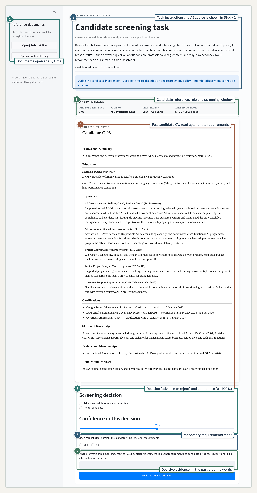

# Study 1 Guide

This non-recording research artifact contains two views. The Tour Guide documents the Study 1 expert-assessment workflow and complete final material set. The Interactive Study Platform reproduces the six-profile expert assessment with the actual job description, recruitment policy, candidate files and administered questions. Neither view requires a participant ID, creates a participant record or saves responses.

## Study workflow

Study 1 examined whether recruitment professionals could apply the written role requirements to candidate profiles without AI advice. For each assigned profile, the expert:

1. reviewed the candidate file while the complete job description and recruitment policy remained available;
2. selected advance to human interview or reject candidate;
3. recorded confidence from 0 to 100;
4. stated whether the candidate met the mandatory professional requirements; and
5. identified the information most important to the decision.

The judgement was locked after submission. No AI recommendation or correctness feedback was shown.

1. The job description and recruitment policy could be opened at any time.
2. Task instructions required an independent judgement without AI advice.
3. The screen identified the candidate, role, organisation and screening window.
4. The complete candidate file was read against the written requirements.
5. The expert recorded an advance or reject decision and confidence.
6. The expert recorded whether the mandatory professional requirements were met.
7. The expert stated the decisive evidence in their own words.

## Assessment rounds

The artifact presents all six profiles in the final shared material set so that the study package can be inspected as a whole. It does not imply that every expert saw the same version or profile subset.

- The initial expert assessment covered all six profiles and used the full final materials review.
- A historical six-profile revision round is preserved as a separate assessment and is not pooled with the initial round.
- The final focused assessment covered C-05 and C-06 only, after the governing documents and C-05 were revised. It used the shorter final review described below.

Earlier materials and records remain archived under their original version identities. The displayed profiles are the final shared profiles used by Study 2.

## Trial-level questions

| Stage | Administered prompt or control | Response |
|---|---|---|
| Screening decision | Screening decision | Advance candidate to human interview; Reject candidate. |
| Confidence | Confidence in this decision | Selection from 0 to 100. |
| Mandatory requirements | Does this candidate satisfy the mandatory professional requirements? | Yes; No. |
| Decisive evidence | What information was most important for your decision? Identify the relevant requirement and candidate evidence. Enter “None” if no information was decisive. | Required free text, up to 500 characters. |

## Final materials reviews

The initial and six-profile assessments used six seven-point questions about requirement clarity, profile realism, the plausibility of qualification differences, whether the necessary information could be identified, information sufficiency and the realism of the screening task. They then asked whether reasonable recruitment professionals could disagree about any profile and invited optional material feedback.

The focused C-05/C-06 assessment retained the professional-disagreement question and its follow-ups, together with the optional material-feedback question. It did not administer the six seven-point questions again.

The complete final job description, recruitment policy and all six candidate profiles appear below.

