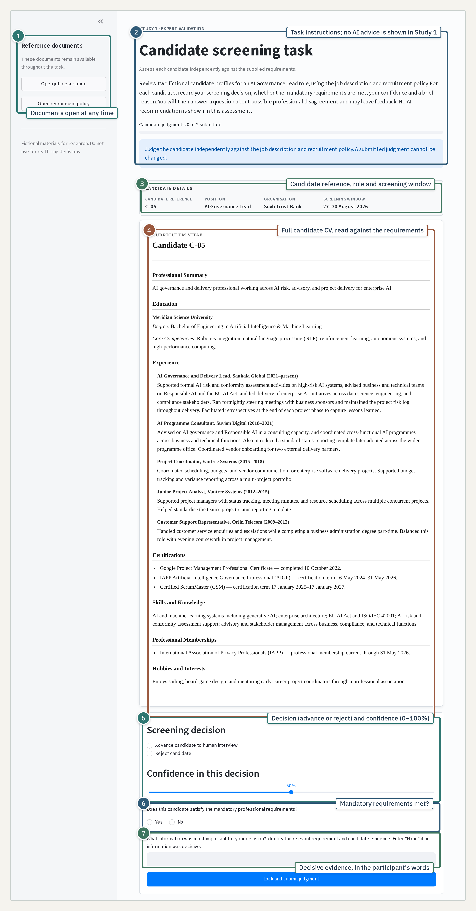
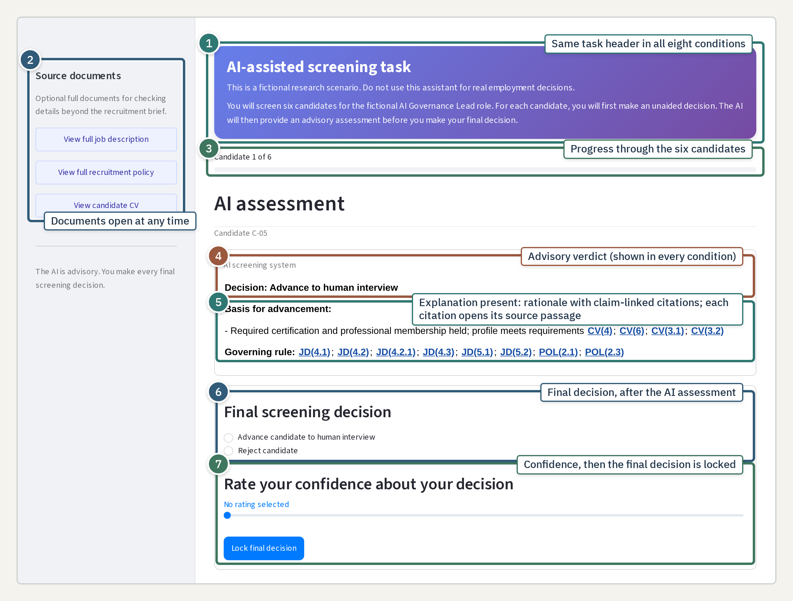

# Study Guide

This non-recording research artifact documents the Study 2 workflow, participant interfaces and questionnaire. The Tour Guide presents the study documentation. The Interactive Study Platform reproduces the assigned condition with the actual six-profile workflow, fixed recommendations and explanation interface. Neither view requires a Prolific ID, creates a participant record or saves responses.

The [Study 1 Guide](https://study1.aitheoryelaboration.org/?guide=true) provides the complete six-profile expert-assessment package used to examine the materials before Study 2.

## Study workflow

Study 1 assessed whether recruitment professionals could apply the written role requirements to the candidate profiles without AI advice. Study 2 used the same six candidate profiles in a controlled AI-assisted screening task. Each participant was assigned to one of eight conditions defined by explanation presence, procedural or anthropomorphic delivery, and cognitive forcing absent or present.

Each Study 2 trial followed the same sequence:

1. The participant reviewed one candidate profile while the complete job description and recruitment policy remained available.
2. The participant recorded an unaided advance or reject decision and selected confidence from 0 to 100.
3. In cognitive-forcing conditions, the participant re-entered both mandatory professional requirements before requesting the AI assessment.
4. The AI assessment presented the fixed recommendation. Explanation-present conditions also showed a rationale with citations that opened the complete source document at the cited passage.
5. The participant could inspect the candidate file, job description and recruitment policy before recording a final decision and confidence.
6. The participant briefly stated the main reason for the final decision.
7. After all six profiles, the participant completed the post-task questionnaire.

## Annotated study screens

### Study 1 expert assessment

1. The job description and recruitment policy could be opened at any time.
2. No AI advice was shown in Study 1, and a submitted judgement could not be changed.
3. The screen identified the candidate, role and screening window.
4. The complete candidate file was read against the written requirements.
5. The expert recorded an advance or reject decision and confidence.
6. The expert recorded whether the mandatory professional requirements were met.
7. The expert stated the decisive evidence in their own words.

### Study 2 AI assessment

1. The same task header appeared in all eight conditions.
2. The complete candidate file, job description and recruitment policy could be opened at any time.
3. Progress was shown across the six candidate profiles.
4. Every condition presented the assigned advisory verdict.
5. Explanation-present conditions added a rationale with claim-linked citations. Each citation opened the complete source document at the cited passage.
6. The participant recorded the final decision after seeing the AI assessment.
7. The participant selected final confidence before locking the decision.

## Trial-level responses

Both confidence controls began without a selected value. Participants had to select a value between 0 and 100, and an intentional response of 50 was valid.

| Stage | Prompt or control | Response |
|---|---|---|
| Initial decision | Initial screening decision | Advance candidate to human interview; Reject candidate. |
| Initial confidence | Rate your confidence about your decision | Explicit selection from 0% to 100%. |
| Requirement re-entry | Before the AI assessment is revealed, use the complete job description to identify and enter both mandatory professional requirements for this role. | Cognitive-forcing conditions only; free text. |
| Final decision | Final screening decision | Advance candidate to human interview; Reject candidate. |
| Final confidence | Rate your confidence about your decision | Explicit selection from 0% to 100%. |
| Main reason | In a few words, what was the main reason for your final decision? | Required free text, limited to 200 characters. |

## Pre-task and background items

| Item | Wording | Response options |
|---|---|---|
| Trust propensity | To what degree do you tend to trust others? | Extremely unlikely; Moderately unlikely; Slightly unlikely; Neither likely nor unlikely; Slightly likely; Moderately likely; Extremely likely. |
| Prior large language model use | How frequently do you use AI systems such as ChatGPT, Claude, Gemini, or Copilot? | Never; Less than once a month; A few times a month; About once a week; Several times a week; Daily. |
| Age | What is your age range? | Under 18; 18–24; 25–34; 35–44; 45–54; 55–64; 65–74; 75–84; 85 or older. |
| Gender | What gender do you identify as? | Male; Female; Non-binary / third gender; Prefer not to say. |
| Education | What is your highest level of education? | Less than high school; High school graduate; Some college; 2 year degree; 4 year degree; Professional degree; Doctorate. |
| Employment | What is your current employment status? | Employed full time; Employed part time; Unemployed looking for work; Unemployed not looking for work; Retired; Student; Disabled. |
| Participant identifier | What is your Prolific ID? | Text field populated from the study link when available. |

## Post-task questionnaire

Agency, perceived provenance-based explainability (PPBE), perceived anthropomorphism (ANT), trust and perceived cognitive engagement (PCE) used a seven-point agreement scale from 1, strongly disagree, to 7, strongly agree. PCE was added in the amended questionnaire during recruitment.

### Agency

- **Agency 1:** I felt in control of the hiring decision.
- **Agency 2:** The final decision reflected my own judgement.
- **Agency 3:** I considered the recommendation without losing sight of my own judgement.
- **Agency 4:** I felt that the decision was ultimately mine.

### Perceived provenance-based explainability

- **PPBE_1:** The assistant made clear which evidence its recommendation was based on.
- **PPBE_2:** I could tell which parts of the source documents the recommendation came from.
- **PPBE_3:** The evidence behind the recommendation was available for me to examine.
- **PPBE_4:** The assistant showed enough of its supporting evidence for the recommendation to be checked.

### Perceived anthropomorphism

- **ANT_1:** Using this assistant gives me the feeling of personal communication.
- **ANT_2:** This assistant behaves human-like.
- **ANT_4:** The assistant communicated with me like a human would.

### Trust

- **TRUST_2:** This assistant has the expertise to assess candidates accurately.
- **TRUST_3:** This assistant has the ability to understand the requirements relevant to the assessment.
- **TRUST_6:** This assistant keeps a fair assessment in mind.
- **TRUST_7:** The assistant provided unbiased recommendations.
- **TRUST_8:** This assistant is honest.
- **TRUST_9:** I consider this assistant to possess integrity.

### Perceived cognitive engagement

- **PCE_1:** Re-entering the role requirements before the AI assessment required me to think carefully about the mandatory requirements.
- **PCE_2:** Re-entering the role requirements before the AI assessment required me to work out what those requirements meant for screening a candidate.
- **PCE_3:** Re-entering the role requirements before the AI assessment required me to evaluate the mandatory requirements for myself.

### Attention item

- **ATTN_1:** To show that you are reading carefully, please select “Somewhat disagree” for this statement.

The expected response was 3, somewhat disagree. The item was not included in the trust score.

## Questionnaire source and adaptation record

The multi-item measures were literature-informed adaptations evaluated in this task. They were not presented as unchanged validated scales.

| Measure | Use in this study | Direct source links |
|---|---|---|
| PPBE | Adapted to whether the evidence for a recommendation could be located, inspected and checked. | [Hamm et al. (2023)](https://doi.org/10.1007/s12525-023-00640-9); [Wang and Benbasat (2016)](https://doi.org/10.1080/07421222.2016.1243949); [Nauta et al. (2023)](https://doi.org/10.1145/3583558); [Kulesza et al. (2015)](https://doi.org/10.1145/2678025.2701399). |
| ANT | Adapted to perceived human-like communication in the task, excluding broader social-presence content. | [Klein and Martinez (2023)](https://doi.org/10.1007/s10660-022-09562-8); [Bartneck et al. (2009)](https://doi.org/10.1007/s12369-008-0001-3). |
| TRUST | Adapted ability- and integrity-related judgements to candidate assessment. | [Benbasat and Wang (2005)](https://doi.org/10.17705/1jais.00065); [Mayer et al. (1995)](https://doi.org/10.2307/258792). |
| PCE | Adapted to careful interpretation and independent evaluation during requirement re-entry. | [Rotgans and Schmidt (2011)](https://doi.org/10.1007/s10459-011-9272-9); [Drosos et al. (2025)](https://doi.org/10.48550/arXiv.2501.17247); [Fischer and Schraffenberger (2025)](https://ceur-ws.org/Vol-4074/short3-2.pdf). |
| Agency | Researcher-developed exploratory block collected after the task. | No external scale was claimed. |
| Single items | Prior large language model use, general interpersonal trust propensity and the instructed-response item. | No external scale was claimed. |
